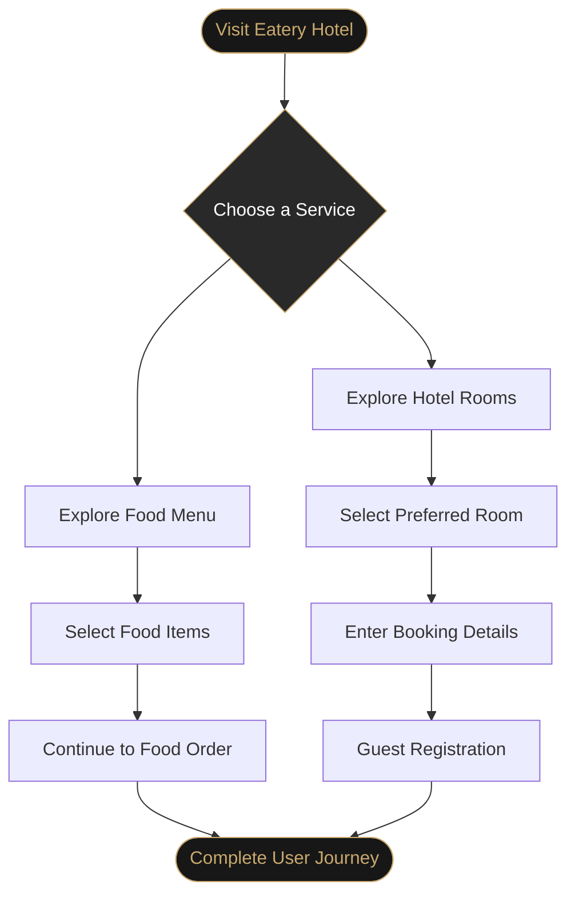

 <div align="center">

  

  <p><b>AN ELEVATED DINING & HOSPITALITY EXPERIENCE</b></p>

  <p>
    
    
    
    
  </p>

  <br/>

  

  <br/>

  <h3>Good Food. Comfortable Stays. Memorable Experiences.</h3>

  <p>
    A modern hospitality web application bringing food ordering,
    hotel room selection, reservations, and guest registration
    together in one convenient destination.
  </p>

  <p>
    <a href="https://github.com/SYED-SAQUEEB/eatery-hotel">
      
    </a>
  </p>

</div>

---

## 📑 Table of Contents

- [About the Project](#-about-the-project)
- [Project Objectives](#-project-objectives)
- [Key Features](#-key-features)
- [Technology Stack](#-technology-stack)
- [Project Workflow](#-project-workflow)
- [Project Structure](#-project-structure)
- [How to Clone and Run](#-how-to-clone-and-run)
- [Responsive Design](#-responsive-design)
- [Future Enhancements](#-future-enhancements)
- [Author](#-author)
- [License](#-license)

---

## 🏨 About the Project

**Eatery Hotel** is a web development project designed to combine restaurant services and hotel accommodation in a single, user-friendly platform.

The application provides an interface where users can explore food options, choose a room according to their preferences, proceed through the stay-booking process, and complete guest registration.

The project focuses on creating an attractive interface, intuitive navigation, organized page layouts, and a responsive experience across desktop, tablet, and mobile devices.

By combining dining and accommodation features, Eatery Hotel aims to make the process of exploring hospitality services more convenient and engaging.

### 🎯 Project Objectives

- Develop an attractive and user-friendly hospitality website.
- Provide an organized interface for browsing food options.
- Make hotel room selection simple and convenient.
- Provide dedicated guest registration and booking interfaces.
- Apply responsive design principles across different screen sizes.
- Build a maintainable frontend using modern web development practices.

---

## ✨ Key Features

<table>
<tr>
<td width="50%" valign="top">

### 🍽️ Food Ordering


- Explore food options.
- Browse menu items.
- Navigate the food-ordering interface.

</td>
<td width="50%" valign="top">

### 🛏️ Room Selection


- Explore room options.
- Compare accommodation choices.
- Select a room according to your requirements.

</td>
</tr>
<tr>
<td width="50%" valign="top">

### 📅 Stay Booking


- Navigate the reservation process.
- Provide the required booking details.
- Explore the stay-planning experience.

</td>
<td width="50%" valign="top">

### 📝 Guest Registration


- Enter guest information.
- Use a dedicated registration page.
- Follow an organized registration workflow.

</td>
</tr>
</table>

---

## 🧰 Technology Stack

The project uses the following frontend technologies.

<table>
<tr>
<th>Technology</th>
<th>Purpose</th>
</tr>
<tr>
<td><b>HTML5</b></td>
<td>Provides the website structure, page content, forms, and semantic markup.</td>
</tr>
<tr>
<td><b>Bootstrap</b></td>
<td>Provides responsive layout utilities, grid components, and ready-to-use UI elements where used.</td>
</tr>
<tr>
<td><b>JavaScript</b></td>
<td>Adds client-side interactivity, event handling, and dynamic interface behavior.</td>
</tr>
<tr>
<td><b>Tailwind CSS</b></td>
<td>Supports utility-based styling, spacing, typography, colors, and responsive design where used.</td>
</tr>
</table>

### Technology Badges

<div align="center">

  

</div>

> **Note:** Bootstrap and Tailwind CSS can both be used in one project, but their styling systems may overlap. Keep the actual technologies that are implemented in your repository and remove any that are not used.

---

## 🔄 Project Workflow

The following diagram illustrates the intended user journey through the application.



---

## 📂 Project Structure

A suggested structure for organizing the Eatery Hotel project is shown below.

```text
eatery-hotel/
│
├── index.html
├── README.md
├── LICENSE
│
├── assets/
│   ├── images/
│   │   ├── logo.png
│   │   ├── hotel-banner.jpg
│   │   ├── food/
│   │   └── rooms/
│   │
│   └── gifs/
│       └── hotel-animation.gif
│
├── css/
│   └── style.css
│
├── js/
│   └── script.js
│
└── pages/
    ├── food-menu.html
    ├── room-booking.html
    └── registration.html
```

### 📁 Folder and File Explanation

| File or Folder | Responsibility |
|---|---|
| `index.html` | Main landing page and primary navigation. |
| `README.md` | Project documentation displayed on GitHub. |
| `LICENSE` | Defines the permissions and conditions for using the project. |
| `assets/images/` | Stores local images, banners, food photographs, and room images. |
| `assets/gifs/` | Stores locally hosted animated GIFs. |
| `css/style.css` | Contains custom styling and visual adjustments. |
| `js/script.js` | Contains client-side JavaScript functionality. |
| `pages/food-menu.html` | Suggested page for food menu browsing and ordering. |
| `pages/room-booking.html` | Suggested page for room selection and booking. |
| `pages/registration.html` | Suggested page for collecting guest information. |

**Important:** This is a recommended organization, not a claim about your current repository. If your existing files have different names or locations, keep your actual structure and update the README accordingly.

---

## 🚀 How to Clone and Run

Follow these steps to download Eatery Hotel and run it locally.

### Step 1 — Install Git

Install Git if it is not already available on your computer.

Download: https://git-scm.com/downloads

Verify the installation:

```bash
git --version
```

### Step 2 — Clone the repository

Open a terminal or Command Prompt and execute:

```bash
git clone https://github.com/SYED-SAQUEEB/eatery-hotel.git
```

This downloads the repository into a folder named `eatery-hotel`.

### Step 3 — Navigate to the project folder

```bash
cd eatery-hotel
```

### Step 4 — Open the project

If the project is a static HTML, CSS, and JavaScript website, you can open `index.html` directly in your browser.

Alternatively, open the folder in Visual Studio Code and launch the site using the Live Server extension if you have it installed.

### Step 5 — Explore the application

Navigate through the available pages and test the implemented functionality:

- Food menu and ordering interface.
- Hotel room selection.
- Stay-booking interface.
- Guest registration form.
- Responsive layouts on different screen sizes.

> If your application uses a backend, build process, or external dependencies, follow the corresponding setup instructions instead of opening the HTML file directly.

### 🔗 Repository URL

```text
https://github.com/SYED-SAQUEEB/eatery-hotel
```

---

## 📱 Responsive Design

Eatery Hotel is intended to provide a consistent experience across different devices.

<div align="center">

  

</div>

- **Desktop:** Spacious layouts and clear content hierarchy.
- **Tablet:** Adaptable content sections and navigation.
- **Mobile:** Compact layouts, readable typography, and accessible controls.

Responsive behavior should be tested against the actual implementation before claiming full device compatibility.

---

## 🔮 Future Enhancements

Potential improvements for future releases include:

- [ ] Interactive food cart and order management.
- [ ] Live room availability.
- [ ] Booking confirmation and notifications.
- [ ] Guest accounts and authentication.
- [ ] Online payment integration.
- [ ] Booking and order history.
- [ ] Hotel administration dashboard.
- [ ] Accessibility and performance improvements.

---

## 🤝 Contributing

Contributions and suggestions are welcome.

1. Fork the repository.
2. Create a feature branch.
3. Implement your changes.
4. Commit and push your work.
5. Open a pull request with a clear explanation.

---

## 👨‍💻 Author

<div align="center">

  <h3>Syed Saqueeb Amjad</h3>

  <p><i>Software Developer | Web Development Enthusiast</i></p>

  <a href="https://github.com/SYED-SAQUEEB">
    
  </a>

  <p>Building user-focused web experiences through thoughtful design and practical development.</p>

</div>

---

## 📄 License

Choose an appropriate license for your project and add its full text in a `LICENSE` file. Update this section to identify the license you have selected.

---

<div align="center">

  

  <p><b>GOOD FOOD · GREAT STAYS · MEMORABLE EXPERIENCES</b></p>

  <p>If you enjoyed this project, consider giving it a ⭐ on GitHub.</p>

</div>
